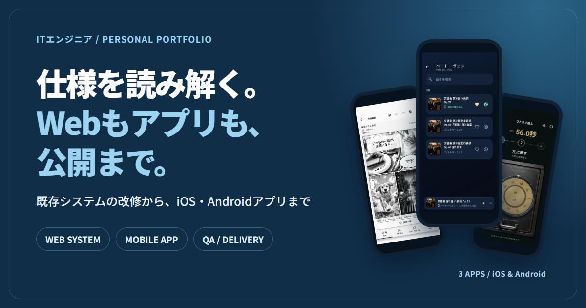

# ITエンジニアの個人ポートフォリオ

PHP・Laravel の既存システム改修とデータ移行、Flutter の iOS・Android アプリ開発。調査、設計、実装、テスト、本番公開まで担当してきた内容を紹介します。

**サイト:** https://en-nagaojunichi.github.io/

## 見ていただきたい事例

| 事例 | 実装・公開内容 |
| --- | --- |
| [MameAd / Laravel](https://en-nagaojunichi.github.io/projects/mamead.html) | 動画生成の Queue 処理、生成結果の検査・アクセス制御、メール通知、テスト |
| [Flutter アプリ 3 本](https://en-nagaojunichi.github.io/projects/flutter.html) | 写真編集、音楽のオフライン再生、オンラインランキング付きゲーム。いずれも iOS・Android で公開 |
| [SEO・MEO 診断ツール](https://mameoffice.com/free-tools/) | 公開ページと店舗案内の確認ツール、計 17 本 |

サイトでは、画面と技術の両面から担当内容を説明しています。受託開発のご相談は[見積依頼フォーム](https://cockpit.mameoffice.com/quote-request)、準委任・チーム開発のご相談はサイト内の連絡先から受け付けています。

## このリポジトリについて

このリポジトリには、個人ポートフォリオサイトのHTML、CSS、画像を収録しています。

### 構成

- `index.html` — プロフィール、開発事例、技術領域、相談先
- `projects/mamead.html` — Laravel / MameAd の設計・実装事例
- `projects/flutter.html` — Flutter / 公開アプリ 3 本の実装事例
- `styles.css` — 共通スタイル
- `assets/` — 自身が開発したサービス・アプリの画面と図
