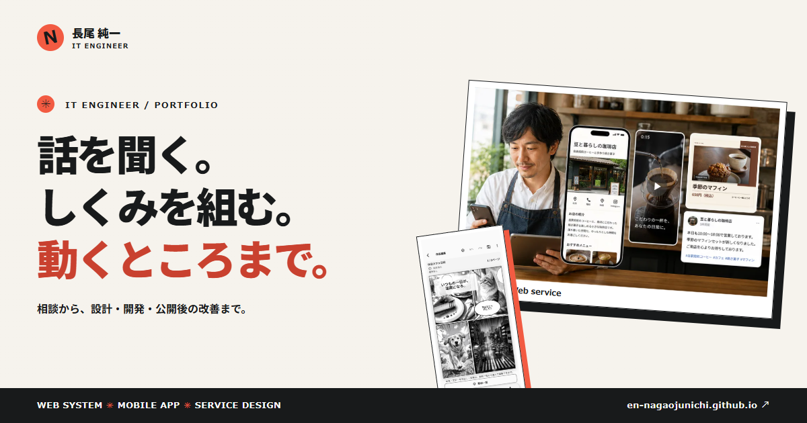

# ITエンジニアのポートフォリオ

業務の話を聞き、既存の仕組みを調べ、必要なものをつくる。Webシステムの改修やデータ移行、アプリの設計・開発・公開まで担当しています。

**[ポートフォリオを見る](https://en-nagaojunichi.github.io/)** · [仕事の相談](https://en-nagaojunichi.github.io/#contact)

## 公開している仕事

- **[MameAd](projects/mamead.html)** — 店舗・事業者向けのWebサービス。紹介ページ、動画、SNS素材の作成から公開後の管理まで。 [サービスを見る](https://mamead.mameoffice.com/)
- **[Flutterアプリ3本](projects/flutter.html)** — 写真編集の「パシャコマ」、音楽再生の「いつでもクラシック」、ゲームの「金庫スプリント」。いずれもApp StoreとGoogle Playで公開しています。
- **[業務画面の公開用サンプル](projects/nextjs.html)** — Next.jsで制作した画面と、設計時に考えたことを紹介します。
- **[SEO・MEOの無料診断ツール](https://mameoffice.com/free-tools/)** — 公開・運用している17本のツールです。

アプリのストアリンクや担当範囲は、各事例ページにまとめています。
